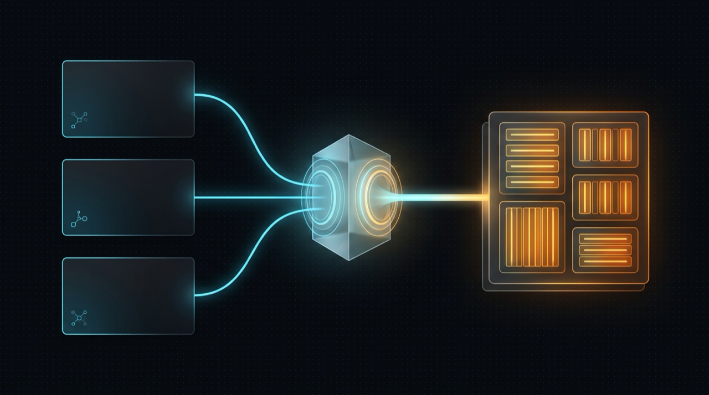
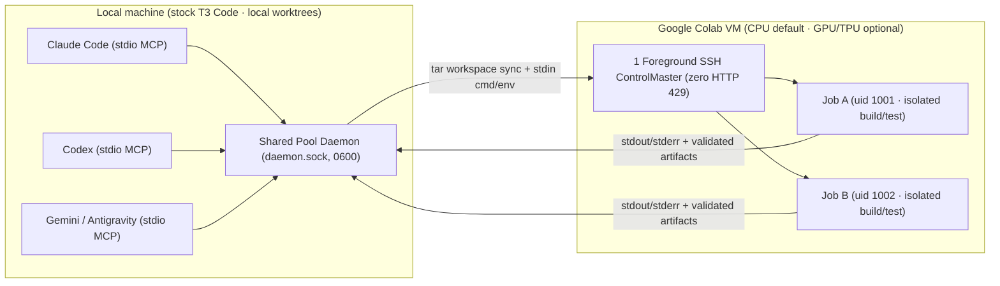

<div align="center">
  
  <h1>Colab Compute MCP</h1>
  <p><strong>Offload heavy builds, compiles, and tests from local AI coding agents to a shared Google Colab VM pool.</strong></p>
  <p>
    <a href="LICENSE"></a>
    
    
    
  </p>
</div>

**Install in T3 Code with one prompt** (paste into any agent):

```text
Install https://github.com/franklinblanco/colab-compute-mcp and configure it as an MCP server for my T3 Code agents (Claude Code, Codex, and Antigravity/Gemini) following its README.
```

<p align="center">
  
</p>

Agents keep editing your local worktrees in stock **T3 Code** (no fork needed) and dispatch test/build commands to warm Google Colab VMs (**CPU by default**). Multiple agents share the same VM concurrently over one foreground SSH `ControlMaster` via a private `0600` Unix-socket daemon (`~/.colab-compute-mcp/daemon.sock`), each in an isolated non-root Linux account.

## How it works



## Installation

**Requirements:** macOS or Linux (or **WSL 2** on Windows), Node.js 22+, `pnpm`, Git, `tar`, OpenSSH, and `flock` (Linux).

### 1. Install and sign in to the Google Colab CLI
```sh
uv tool install google-colab-cli   # or: pip install google-colab-cli
colab usage                        # one-time Google sign-in; prints your compute-unit balance
```

### 2. Clone and build this MCP server
```sh
git clone https://github.com/franklinblanco/colab-compute-mcp.git
cd colab-compute-mcp
pnpm install --frozen-lockfile
pnpm run build
```

### 3. Register `colab-compute` for your T3 Code agents
Use the absolute paths to `node` (e.g. `which node`) and `dist/cli.js`:

* **Claude Code** (`~/.claude.json` under `"mcpServers"`):
  ```json
  "colab-compute": {
    "type": "stdio",
    "command": "/path/to/node",
    "args": ["/path/to/colab-compute-mcp/dist/cli.js"]
  }
  ```
* **Codex** (`~/.codex/config.toml`):
  ```toml
  [mcp_servers.colab-compute]
  command = "/path/to/node"
  args = ["/path/to/colab-compute-mcp/dist/cli.js"]
  ```
* **Gemini / Antigravity** (`~/.gemini/config/mcp_config.json`, plus `~/.t3/userdata/providers/antigravity/*/config/mcp_config.json` when running inside T3 Code):
  ```json
  {
    "mcpServers": {
      "colab-compute": {
        "command": "/path/to/node",
        "args": ["/path/to/colab-compute-mcp/dist/cli.js"]
      }
    }
  }
  ```

Start a new thread and ask your agent to check `colab_pool_status`.

> **Windows:** Native Windows is not supported (`google-colab-cli` is Linux/macOS only and Windows OpenSSH lacks `ControlMaster`). Run inside **WSL 2**; Windows MCP clients can launch it via `"command": "wsl.exe"`, `"args": ["--", "node", "/path/in/wsl/colab-compute-mcp/dist/cli.js"]`.

## Google AI Pro & Ultra compute estimates

Paid Google AI plans include monthly **Colab Compute Units (CU)** automatically on the same Google account (**Pro: 200 CU/mo**, **Ultra: up to 2,000 CU/mo**; units expire after 90 days and fall back to free-tier quotas at `0` with no overage billing).

Approximate runtime hours per monthly grant *(rates fluctuate slightly with demand; check live rates via `colab_pool_status` or `colab usage`)*:

| Hardware profile | Typical specs | Approx. CU/hr | Google AI Pro (200 CU) | Google AI Ultra (2,000 CU) |
| --- | --- | --- | --- | --- |
| `cpu` *(default)* | 2 vCPU, ~13 GB RAM | ~0.07 | ~2,850 hrs | ~28,500 hrs |
| `cpu-high-mem` | 8 vCPU, ~52 GB RAM | ~0.14 | ~1,400 hrs | ~14,200 hrs |
| `gpu-t4` | 15 GB VRAM | ~1.1 – 1.8 | ~110 – 180 hrs | ~1,100 – 1,800 hrs |
| `gpu-l4` | 22 GB VRAM | ~1.5 – 4.8 | ~40 – 130 hrs | ~415 – 1,300 hrs |
| `gpu-g4` *(Pro+/Ultra)* | 96 GB VRAM (RTX PRO 6000) | ~8.9 | — | ~225 hrs |
| `gpu-a100` | 40–80 GB VRAM | ~7 – 15 | ~13 – 28 hrs | ~130 – 285 hrs |
| `gpu-h100` *(Pro+/Ultra)* | 80 GB VRAM | ~18 | — | ~110 hrs |
| `tpu-v5e1` / `tpu-v6e1` | 16–32 GB HBM | ~1.8 / ~4.1 | ~110 / ~48 hrs | ~1,100 / ~485 hrs |

For everyday builds and test suites, **`cpu`** and **`cpu-high-mem`** barely dent your monthly balance, and idle VMs auto-stop after 10 minutes.

## MCP tools

| Tool | Purpose |
| --- | --- |
| `colab_run_job` | Run a build/test command on a pooled Colab VM (`hardware` defaults to `cpu`, `syncWorkspace: true`, `mode: "wait"` or `"async"`). Syncs local `.gitignore`-aware files (including uncommitted edits) and optionally copies back `artifactPaths`. |
| `colab_job_status` | Read status, exit code, stdout/stderr (up to 64 KiB each), and artifacts for a job from the current session. |
| `colab_cancel_job` | Cancel a queued or running job and free its VM slot immediately. |
| `colab_pool_status` | Show active VMs, slot usage, queued jobs, and Colab compute-unit balance. |
| `colab_pool_stop` | Stop idle VMs (or `force: true` for VMs whose active jobs belong to the current session). |

## Configuration & security

| Environment variable | Default | Notes |
| --- | --- | --- |
| `COLAB_MCP_MAX_VMS` | `2` | Maximum concurrent Colab VMs in the pool |
| `COLAB_MCP_IDLE_TIMEOUT_SECONDS` | `600` | Idle VM auto-stop timeout (10 min) |
| `COLAB_MCP_MAX_JOBS_PER_CPU_VM` | `2` | Concurrent jobs per `cpu` VM |
| `COLAB_MCP_MAX_JOBS_PER_HIGH_MEM_VM` | `4` | Concurrent jobs per `cpu-high-mem` VM |
| `COLAB_MCP_STATE_DIR` | `~/.colab-compute-mcp` | Private socket, SSH key, and session state |

* Each job runs under a disposable non-root Linux account in `/content/t3-jobs/<jobId>` with commands and `env` sent over SSH stdin (never argv).
* Workspace uploads exclude `.git` and `.t3` (and `node_modules`/`target`/`dist`/`.venv` outside Git); downloaded artifacts reject symlinks, hard links, and path traversal.
* Pool reconciles orphaned VMs on startup and stops all pool-owned VMs on `SIGTERM`/`SIGINT`.

## Verify

```sh
pnpm test          # unit tests (fake transport)
pnpm run test:live # live 2-client concurrent test on your Colab account (expects 0 active sessions)
```

License: [MIT](LICENSE) — remote supervisor and pool architecture adapted from T3 Code.
